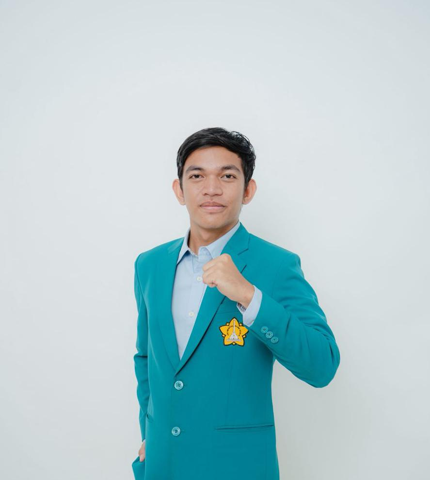

# Bem Election Campaign

Landing kampanye pemilihan Ketua BEM — **Hamdan, nomor urut 01** — dengan
visi-misi, program kerja, tahapan pemilihan, simulasi coblos interaktif,
dan formulir dukungan. Situs statis (HTML/CSS/JS murni, tanpa build,
tanpa backend, tanpa server).

**Live:** https://bem-election.pages.dev/



> **Kejujuran isi:** repo asli hanya berisi foto kandidat dan dokumen
> generik — tidak ada nama lengkap, fakultas, tanggal pemilihan, atau
> program kerja resmi. Karena itu slogan, visi-misi, dan 5 program kerja
> di situs ini adalah **konten contoh template** yang wajib diganti tim
> kampanye dengan data resmi sebelum dipakai sungguhan. Simulasi coblos
> adalah latihan di perangkatmu saja — **bukan suara resmi** — dan tidak
> ada tanggal pemilihan palsu (tanggal resmi diumumkan panitia pemilihan).

## Isi halaman

| Bagian | Isi |
|---|---|
| Hero | Nama raksasa, nomor urut 01, slogan, foto kandidat dalam bingkai arch, CTA |
| Visi & Misi | Pernyataan visi + 3 misi |
| Program Kerja | 5 program bernomor, klik untuk melihat cara kerjanya |
| Tahapan | 4 langkah: kenali calon → baca program → simulasi coblos → bilik suara |
| Simulasi Coblos | Kartu surat suara interaktif — klik untuk mencoblos, stempel COBLOS muncul |
| Dukung | Formulir dukungan (tersimpan lokal di perangkatmu, tidak dikirim ke mana pun) |
| Tanya Jawab | 4 pertanyaan soal simulasi, isi contoh, dan data |

## Menjalankan lokal

```bash
# Tanpa instalasi apa pun — cukup server statis:
python3 -m http.server 8395 --bind 127.0.0.1
# buka http://127.0.0.1:8395
```

## Tech stack

- HTML/CSS/JavaScript murni — tanpa framework, tanpa build step.
- Font: Archivo (display/body) + IBM Plex Mono (label/nomor).
- State interaktif: `localStorage` perangkat pengunjung (simulasi coblos
  + daftar dukungan). Tidak ada server, basis data, atau pelacak.
- Foto kandidat: `hamdan.png` (aset asli repo).

## Struktur proyek

```
index.html                  Halaman tunggal
styles.css                  Semua gaya (palet docs/DESIGN.md)
app.js                      Menu mobile, simulasi coblos, formulir dukungan
hamdan.png                  Foto kandidat
og-image.png                Kartu preview 1200x630 (PIL)
favicon.svg                 Ikon "01"
e2e/site.spec.ts            Playwright e2e (desktop + mobile)
playwright.config.ts        Server statis lokal port 4174
scripts/
  check-static.mjs          Gate P0 + OG + kejujuran isi
  smoke.mjs                 Smoke folder deploy
  advisory-sweep.py         Sweep OSV (produksi saja)
  make-og-image.py          Generator og-image.png
docs/
  DESIGN.md                 Kontrak arah desain (referensi: Framer Politica)
  ARCHITECTURE.md           Struktur + keputusan arsitektur
  TESTING.md                Piramida pengujian + batas VM dev
  DEPLOY.md                 Cara deploy + verifikasi live
  PRD.md                    PRD produk yang sebenarnya
  diagrams.html             Diagram arsitektur + alur (HTML+SVG)
  og-preview.md             Spesifikasi kartu preview tautan
```

## Pengujian

| Lapisan | Perintah |
|---|---|
| Validasi HTML | `npx html-validate index.html` |
| Gate P0 + OG | `npm run validate` |
| Advisory OSV | `python3 scripts/advisory-sweep.py` |
| E2E (desktop + mobile) | `npx playwright test` |
| Smoke folder deploy | `npm run smoke` |

Semua lapisan berjalan di CI (`.github/workflows/ci.yml`, 4 job) pada
tiap push dan PR ke `main`. Detail + batas VM dev: `docs/testing.md`.

## Menyesuaikan untuk tim kampanye

1. Ganti foto: timpa `hamdan.png` (rasio 1:1).
2. Ganti nama, nomor urut, slogan di `index.html` (hero, footer, kartu
   surat suara, `<title>`, tag OG).
3. Ganti 5 program kerja, visi-misi, dan FAQ dengan data resmi.
4. Regenerasi kartu preview: `python3 scripts/make-og-image.py`.
5. Deploy ulang — lihat `docs/deploy.md`.

## Follow-up (bukan gate merge)

- **Screenshot isi web** untuk README (desktop + mobile) — butuh
  browser live; screenshot lokal tidak bisa di VM saat ini
  (lihat `docs/testing.md` § "Batas VM dev").
- **Video demo** walkthrough dari sistem live — sama, butuh browser live.

## Lisensi

MIT — lihat [LICENSE](./LICENSE).

---
_Dikembangkan oleh **dezzorigin** (Nabil Aulia Dika)._
